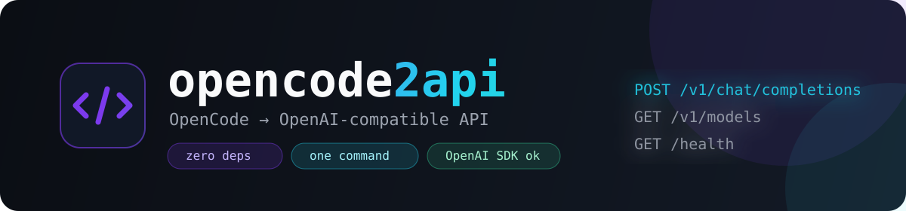
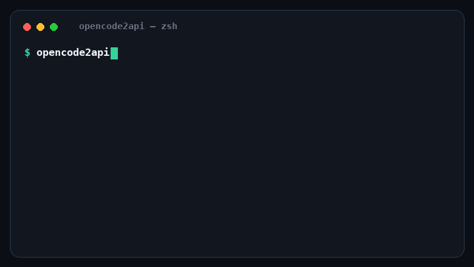
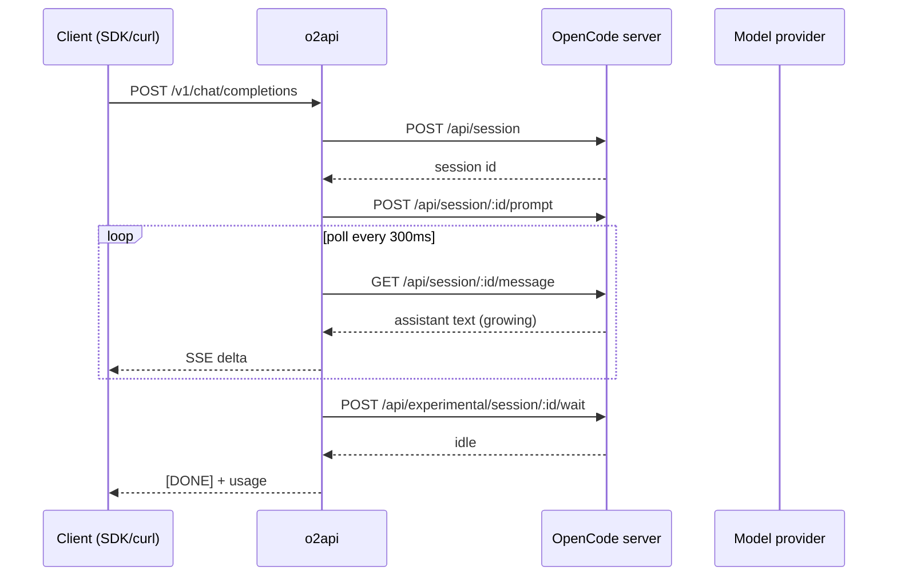

<div align="center">



<h1>o2api</h1>

<p><strong>Use <a href="https://opencode.ai">OpenCode</a> as an OpenAI-compatible API.</strong><br/>
One command. Zero dependencies. Your existing tools just work.</p>

[](LICENSE)
[](https://nodejs.org)
[](package.json)
[](https://github.com/Tandarke12345560/o2api/pulls)
[](https://platform.openai.com/docs/api-reference)

<br/>



<br/>
<br/>

**`POST /v1/chat/completions`** · **`GET /v1/models`** · **`GET /health`**

</div>

---

## ✨ What is this?

`o2api` puts a clean, OpenAI-compatible HTTP API in front of a **real, running OpenCode
server**. It does not impersonate anything: it uses OpenCode's own HTTP API (sessions, prompts,
messages), so requests genuinely originate from the OpenCode client on your machine.

```text
 your app / SDK / agent
          │  POST /v1/chat/completions
          ▼
   ┌─────────────────┐
   │  o2api   │  ← this project (single file, no deps)
   └────────┬────────┘
            │  OpenCode HTTP API (Basic auth)
            ▼
   ┌─────────────────┐
   │  OpenCode       │  sessions · prompts · tools · models
   └────────┬────────┘
            ▼
     any provider: free · Go · BYOK · local
```

**Why?** Because everything speaks OpenAI now — SDKs, agents, IDE plugins, automation tools,
n8n, LangChain, Continue, Cursor, Claude Code. This lets your OpenCode setup join that ecosystem
without writing glue code.

> [!NOTE]
> This is a **bridge**, not a bypass. It uses the official OpenCode API and respects your
> OpenCode configuration, permissions, and provider limits.

---

## 🚀 Features

| | Feature | Detail |
|---|---|---|
| ⚡ | **One command** | `npx o2api` — no build, no install, no config file |
| 🪶 | **Zero dependencies** | Only Node built-ins (`http`, `fs`, `path`) and global `fetch` |
| 🔌 | **OpenAI-compatible** | Chat Completions, streaming SSE, `usage`, `finish_reason`, `[DONE]` |
| 🧠 | **All your models** | Whatever OpenCode exposes — free, Go, BYOK, Ollama, vLLM |
| 🔁 | **Multi-turn sessions** | Reuse an OpenCode session with `x-session-id` |
| 🌊 | **Streaming** | Real deltas, not a single blob |
| 🧮 | **Token aware** | Honors `max_tokens`, trims history to the model context window, reports `limit` |
| 🔐 | **Optional auth** | Bearer token for LAN / shared machines |
| 🌍 | **LAN ready** | `--host 0.0.0.0` when you need it |
| 🩺 | **Health check** | `/health` reports upstream version |
| 🧩 | **Tiny surface** | One file, no dependencies, easy to audit and fork |

---

## 📦 Quick start

### 1. Requirements

- **OpenCode v2** installed and running (`opencode --version`)
- **Node.js ≥ 22**

### 2. Run it

```bash
npx o2api
```

or from a clone:

```bash
git clone https://github.com/Tandarke12345560/o2api.git
cd o2api
node server.mjs
```

You'll see:

```text
  o2api v1.0.0
  OpenCode → OpenAI-compatible API

  ➜ Local     http://127.0.0.1:8787/v1
  ➜ Upstream  http://127.0.0.1:49374
  ➜ Workdir   /home/you
  ➜ Auth      open (localhost only)
```

### 3. Ask something

```bash
curl -s http://127.0.0.1:8787/v1/chat/completions \
  -H 'content-type: application/json' \
  -d '{
    "model": "flint-40b-free",
    "messages": [{ "role": "user", "content": "Say hi in one word." }]
  }'
```

```json
{
  "id": "chatcmpl_1793300022634",
  "object": "chat.completion",
  "model": "flint-40b-free",
  "choices": [
    { "index": 0, "message": { "role": "assistant", "content": "Hi" }, "finish_reason": "stop" }
  ],
  "usage": { "prompt_tokens": 5061, "completion_tokens": 42, "total_tokens": 5103 },
  "opencode": { "session_id": "ses_...", "reused": false }
}
```

---

## 🧞 One-command alias

Install once, then it's just `o2api` everywhere:

```bash
./install.sh          # symlinks /usr/local/bin/o2api
# or
npm i -g .            # global npm bin
# or, no install at all:
echo "alias o2api='node $PWD/server.mjs'" >> ~/.zshrc && source ~/.zshrc
```

Then:

```bash
o2api --port 8080 --key sk-local
```

---

## 🎛 Usage

### Streaming

```bash
curl -N http://127.0.0.1:8787/v1/chat/completions \
  -H 'content-type: application/json' \
  -d '{"model":"flint-40b-free","stream":true,"messages":[{"role":"user","content":"Count 1 to 5"}]}'
```

```text
data: {"choices":[{"delta":{"role":"assistant","content":""},"finish_reason":null}]}
data: {"choices":[{"delta":{"content":"1\n2\n3\n4\n5"},"finish_reason":null}]}
data: {"choices":[{"delta":{},"finish_reason":"stop"}]}
data: {"choices":[],"usage":{"prompt_tokens":5059,"completion_tokens":686,"total_tokens":5745}}
data: [DONE]
```

### Python (OpenAI SDK)

```python
from openai import OpenAI

client = OpenAI(base_url="http://127.0.0.1:8787/v1", api_key="not-needed")

stream = client.chat.completions.create(
    model="flint-40b-free",
    messages=[{"role": "user", "content": "Explain this repo"}],
    stream=True,
)
for chunk in stream:
    print(chunk.choices[0].delta.content or "", end="", flush=True)
```

### Node / TypeScript

```ts
import OpenAI from "openai";

const client = new OpenAI({
  baseURL: "http://127.0.0.1:8787/v1",
  apiKey: process.env.BRIDGE_API_KEY ?? "not-needed",
});

const res = await client.chat.completions.create({
  model: "flint-40b-free",
  messages: [{ role: "user", content: "Write a haiku about proxies." }],
});
console.log(res.choices[0].message.content);
```

### Claude Code

Claude Code speaks the Anthropic API. Point it at the bridge's OpenAI endpoint through a
compatible gateway — or use OpenCode directly with `/connect`. See [`examples/`](examples/).

### Multi-turn conversations

Stateless by default (each request = fresh session, full history flattened into one prompt).
Give a key to keep the session alive:

```bash
curl -s http://127.0.0.1:8787/v1/chat/completions \
  -H 'content-type: application/json' \
  -H 'x-session-id: chat-42' \
  -d '{"model":"flint-40b-free","messages":[{"role":"user","content":"My name is Kerem."}]}'
```

Next call with the same `x-session-id` sends only the newest message; OpenCode keeps the history.
Idle sessions expire after one hour by default (`--session-ttl`). Changing the `model` or `agent`
on a reused session switches the OpenCode session in place.

### Token limits

The bridge reads each model's real `limit.context` / `limit.output` from OpenCode and exposes it
in `GET /v1/models`:

```json
{
  "id": "flint-40b-free",
  "context": 262144,
  "max_output_tokens": 65536,
  "limit": { "context": 262144, "output": 65536 }
}
```

How requests are kept inside the limit:

- **`max_tokens` / `max_completion_tokens` are enforced.** Non-stream responses are truncated and
  `finish_reason` becomes `"length"`; streams stop at the cap and interrupt the OpenCode turn so
  you do not pay for the rest of the generation.
- **Long prompts are trimmed, not rejected.** Older conversation messages are dropped first, the
  newest user message is kept, and a small `[o2api]` system note says how many were omitted.
- **OpenCode's own prompt is reserved.** `--context-overhead` (default `8192` tokens) covers the
  agent system prompt and tool definitions. Set `--max-prompt-tokens` to hard-cap the forwarded
  prompt regardless of the model.
- **Upstream errors are surfaced.** A model/context error from OpenCode is returned as an
  OpenAI-style `{ "error": { ... } }` response instead of an empty `200`.

When you use the bridge as a provider inside another OpenCode instance, copy the real
`limit.context` and `limit.output` values into that provider's model config. Otherwise OpenCode
falls back to its 200k/32k default and may send requests the underlying model cannot accept.


### List models

```bash
curl -s http://127.0.0.1:8787/v1/models | jq -r '.data[].id'
```

---

## 🔌 Endpoints

| Method | Path | Description |
|---|---|---|
| `POST` | `/v1/chat/completions` | OpenAI Chat Completions (stream + non-stream) |
| `GET` | `/v1/models` | Models available in your OpenCode |
| `GET` | `/health` | Upstream status + OpenCode version |

---

## ⚙️ Configuration

Flags win over environment variables. Every setting has both.

| Flag | Env | Default | Description |
|---|---|---|---|
| `-p, --port` | `PORT` | `8787` | Listen port |
| `-H, --host` | `HOST` | `127.0.0.1` | Bind address (`0.0.0.0` for LAN) |
| `-k, --key` | `BRIDGE_API_KEY` | — | Require `Authorization: Bearer …` |
| `-m, --model` | `DEFAULT_MODEL` | first available | Default model id |
| `-a, --agent` | `DEFAULT_AGENT` | `build` | `build` or `plan` |
| `-d, --workdir` | `WORKDIR` | `cwd` | Directory the agent operates in |
| `-u, --url` | `OPENCODE_URL` | `http://127.0.0.1:49374` | OpenCode server URL |
| `--password` | `OPENCODE_PASSWORD` | `service.json` | OpenCode service password |
| `--cors` | `CORS_ORIGINS` | — | Comma-separated browser origins allowed to call the API |
| `--allowed-host` | `ALLOWED_HOSTS` | loopback + local IPs | Extra `Host` header values to accept |
| `--max-prompt-tokens` | `MAX_PROMPT_TOKENS` | `0` (model context) | Hard cap for forwarded prompt tokens |
| `--context-overhead` | `CONTEXT_OVERHEAD_TOKENS` | `8192` | Tokens reserved for OpenCode's system prompt/tools |
| `--timeout` | `REQUEST_TIMEOUT` | `600` | Per-request timeout in seconds |
| `--session-ttl` | `SESSION_TTL` | `3600` | Idle lifetime of `x-session-id` sessions |

```bash
o2api --help
```

> Binding to anything other than loopback **requires** `--key`; the server refuses to start
> without it.

---

## 🏗 Architecture



<details>
<summary><strong>Request lifecycle (non-stream)</strong></summary>

1. Parse OpenAI body → resolve `model` via `/api/model`.
2. Create (or reuse) an OpenCode session.
3. Flatten `messages[]` into a single prompt (`System: … / User: … / Assistant: …`),
   trimming the oldest turns to fit `limit.context − limit.output − overhead`.
4. `POST /prompt`, then `POST /wait` until the agent loop is idle (or `max_tokens` is reached).
5. Read messages, keep only `type: "text"` parts of the assistant messages in this turn.
6. Map tokens → `usage`, finish reason, return `chat.completion`.
7. Delete the session if it was stateless.

</details>

---

## 🔐 Security

- **Localhost by default.** Nothing is exposed until you pass `--host 0.0.0.0`.
- **Always set `--key` when binding beyond localhost.** Anyone on the network can otherwise drive
  your agent — including file and shell tools, depending on your permissions.
- **Never expose it to the public internet** without a reverse proxy, TLS, and rate limiting.
- **Host/Origin allowlists.** Requests with a foreign `Host` header are rejected (DNS rebinding),
  and browser requests are only answered for origins passed via `--cors` (no wildcard CORS).
- The bridge reads `~/.config/opencode/service.json`; the password never leaves your machine
  except to your own OpenCode server.

---

## ⚠️ Limits & caveats

- **Agent API, not pure chat.** OpenCode can run tools; the bridge returns only the final text.
  Tool calls are not forwarded to the client as structured calls.
- **~5k token floor.** Every request carries OpenCode's system prompt. The bridge reserves 8k
  tokens for it when trimming history; raise `--context-overhead` if your agents add large
  instructions or tool descriptions.
- **`max_tokens` is enforced on the bridge side.** OpenCode's prompt API has no per-request output
  limit, so the bridge truncates and interrupts. The provider may still bill for tokens generated
  before the interrupt, especially reasoning tokens.
- **Streaming granularity is 300 ms** (message polling), not token-level.
- **Permissions** follow your OpenCode config. For unattended use, define `permissions`
  explicitly — an `ask` rule will block a request until answered (or `--timeout` fires).
- **Provider limits still apply.** Free tiers, Go limits, and rate limits are unchanged.

---

## ❓ FAQ

<details>
<summary><strong>Does this bypass billing or limits?</strong></summary>

No. It runs your existing OpenCode instance and its configured providers. Quotas, limits, and
terms are exactly the same as using OpenCode normally.

</details>

<details>
<summary><strong>Do I need an OpenAI API key?</strong></summary>

No. The `api_key` in your SDK can be any string, unless you set `--key` on the bridge — then use
that value.

</details>

<details>
<summary><strong>Which models can I use?</strong></summary>

Anything visible in `GET /v1/models` — whatever your OpenCode has connected (free models, Go,
BYOK, Ollama, vLLM, OpenRouter, …).

</details>

<details>
<summary><strong>Can I run it in Docker?</strong></summary>

Yes — see [`Dockerfile`](Dockerfile).

```bash
docker build -t o2api .
docker run --rm --network host o2api          # Linux: container reaches 127.0.0.1:49374

# LAN / other hosts (key is mandatory off-loopback):
docker run --rm --network host \
  -e HOST=0.0.0.0 -e BRIDGE_API_KEY="$(openssl rand -hex 24)" o2api
```

</details>

<details>
<summary><strong>Why does the first token take a while?</strong></summary>

OpenCode boots a session, loads context, and may consult tools before answering. Warm sessions
(`x-session-id`) are noticeably faster.

</details>

---

## 🗺 Roadmap

- [x] Chat Completions + streaming
- [x] Model discovery
- [x] Session reuse
- [x] Bearer auth
- [ ] `/v1/messages` (Anthropic-compatible) for Claude Code
- [ ] `/v1/responses` (OpenAI Responses API)
- [ ] Proper tool-call passthrough
- [ ] Docker image + compose example
- [ ] systemd unit + launchd plist

PRs welcome — keep the dependency count at zero. 🧡

---

## 🤝 Contributing

```bash
git clone https://github.com/Tandarke12345560/o2api.git
cd o2api
node --check server.mjs   # syntax
node server.mjs --help    # smoke
```

Small, focused PRs. One feature per PR. No new dependencies without a very good reason.

---

## ⚖️ Disclaimer

> **Read this before using o2api.** Full text: [DISCLAIMER.md](DISCLAIMER.md)

- **Not affiliated** with OpenCode, Anomaly, Alibaba, Qwen, OpenAI, Anthropic, Google, or any model
  provider. All trademarks belong to their owners.
- **A bridge, not a bypass.** o2api calls the official HTTP API of the OpenCode server *you* run.
  It does **not** bypass billing, quotas, rate limits, or access controls, and it does not
  impersonate clients or share accounts.
- **You are responsible** for complying with the OpenCode terms of service, your model providers'
  terms, and applicable law (GDPR, KVKK, …) when sending data through a model.
- **Secure your install.** Localhost by default; use `--key` before binding to a network; never
  expose it to the public internet without TLS, auth, and rate limiting.
- **No warranty.** Provided "as is" under the [Apache License 2.0](LICENSE). The authors are not liable
  for account suspension, quota exhaustion, model output, data loss, or security incidents
  resulting from use or misconfiguration.

---

## 📄 License

[Apache License 2.0](LICENSE) © contributors — see also [NOTICE](NOTICE).

Apache 2.0 is used deliberately instead of MIT: it includes an **express patent grant** and a
**patent retaliation clause**, which is what most companies need before adopting a project
internally.

OpenCode itself is a separate project with its own license and terms of service.

---

<div align="center">

**If this saved you an afternoon, a ⭐ helps other people find it.**

<a href="https://github.com/Tandarke12345560/o2api/stargazers">⭐ Star</a> ·
<a href="https://github.com/Tandarke12345560/o2api/issues">🐛 Issues</a> ·
<a href="https://github.com/Tandarke12345560/o2api/discussions">💬 Discussions</a>

</div>
