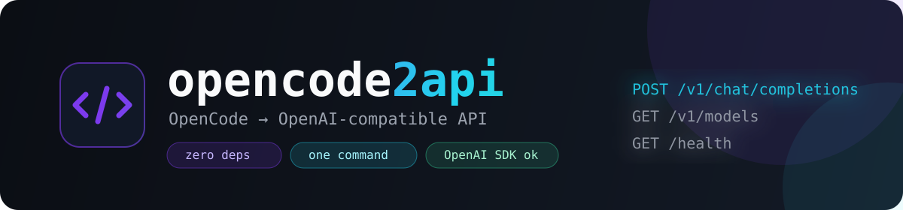

<div align="center">



<h1>o2api</h1>

<p><strong>OpenCode'u OpenAI-uyumlu bir API'ye çevir.</strong><br/>
Tek komut. Sıfır bağımlılık. Mevcut araçların olduğu gibi çalışır.</p>

</div>

> 🇬🇧 English: [README.md](README.md)

---

## ✨ Nedir?

Çalışan bir **OpenCode sunucusunun** önüne temiz bir OpenAI-uyumlu HTTP API koyar.
Taklit yok: OpenCode'un kendi API'sini (session, prompt, message) kullanır.

```text
 uygulaman / SDK / agent
          │  POST /v1/chat/completions
          ▼
   ┌─────────────────┐
   │  o2api   │  ← tek dosya, bağımlılık yok
   └────────┬────────┘
            │  OpenCode HTTP API (Basic auth)
            ▼
   ┌─────────────────┐
   │  OpenCode       │  oturum · prompt · araçlar · modeller
   └────────┬────────┘
            ▼
   istediğin sağlayıcı: free · Go · BYOK · yerel
```

---

## 🚀 Hızlı başlangıç

**Gereksinim:** OpenCode v2 çalışıyor + Node.js ≥ 22

```bash
npx o2api
# ➜ http://127.0.0.1:8787/v1
```

veya:

```bash
git clone https://github.com/yourname/o2api.git
cd o2api && node server.mjs
```

İlk istek:

```bash
curl -s http://127.0.0.1:8787/v1/chat/completions \
  -H 'content-type: application/json' \
  -d '{"model":"flint-40b-free","messages":[{"role":"user","content":"Merhaba"}]}'
```

Python SDK:

```python
from openai import OpenAI
client = OpenAI(base_url="http://127.0.0.1:8787/v1", api_key="not-needed")
print(client.chat.completions.create(
    model="flint-40b-free",
    messages=[{"role": "user", "content": "Merhaba"}],
).choices[0].message.content)
```

---

## 🧞 Tek komut (alias)

```bash
./install.sh                                    # /usr/local/bin/o2api
npm i -g .                                      # global npm
echo "alias o2api='node $PWD/server.mjs'" >> ~/.bashrc   # alias
```

Sonrası:

```bash
o2api --port 8080 --key sk-local
```

---

## 🔌 Uçlar

| Metot | Yol | Açıklama |
|---|---|---|
| `POST` | `/v1/chat/completions` | OpenAI Chat Completions (stream + normal) |
| `GET` | `/v1/models` | OpenCode'daki modeller |
| `GET` | `/health` | Upstream durumu + sürüm |

---

## ⚙️ Ayarlar

| Bayrak | Env | Varsayılan | Açıklama |
|---|---|---|---|
| `-p, --port` | `PORT` | `8787` | Port |
| `-H, --host` | `HOST` | `127.0.0.1` | Bind adresi (`0.0.0.0` = LAN) |
| `-k, --key` | `BRIDGE_API_KEY` | — | `Authorization: Bearer …` zorunlu |
| `-m, --model` | `DEFAULT_MODEL` | ilk model | Varsayılan model |
| `-a, --agent` | `DEFAULT_AGENT` | `build` | `build` veya `plan` |
| `-d, --workdir` | `WORKDIR` | cwd | Ajanın çalışma dizini |
| `-u, --url` | `OPENCODE_URL` | `http://127.0.0.1:49374` | OpenCode adresi |
| `--password` | `OPENCODE_PASSWORD` | `service.json` | Servis şifresi |

```bash
o2api --help
```

---

## 🔁 Çok turlu konuşma

Varsayılan olarak her istek bağımsızdır. Oturumu sürdürmek için:

```bash
curl ... -H 'x-session-id: sohbet-1' ...
```

Aynı anahtarla gelen sonraki istekte sadece yeni mesaj gönderilir; geçmiş OpenCode'ta kalır.

---

## 🔐 Güvenlik

- Varsayılan olarak **sadece localhost**.
- `--host 0.0.0.0` kullanacaksan **mutlaka `--key`** ver.
- İnternete açma; gerekiyorsa reverse proxy + TLS + rate limit.
- Şifre `~/.config/opencode/service.json`'dan okunur, dışarı çıkmaz.

---

## ⚠️ Sınırlar

- **Ajan API'si, saf chat değil** — araç çağrıları istemciye aktarılmaz.
- **~5k token taban** — her istek OpenCode sistem prompt'unu taşır.
- **Streaming 300 ms** dilimlerle (polling).
- **İzinler** OpenCode yapılandırmasına tabi; `ask` kuralı isteği bekletir.
- **Sağlayıcı limitleri** aynen geçerli.

---

## 📄 Lisans

[MIT](LICENSE). OpenCode ayrı bir projedir; kendi lisansı ve kullanım şartları geçerlidir.
